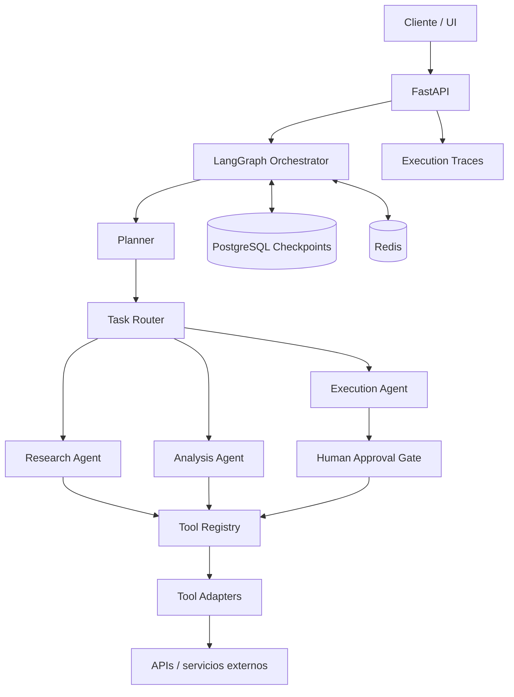

# AgentLab

> Framework modular para construir, orquestar y evaluar agentes de inteligencia artificial que utilizan herramientas externas.

**Estado:** planificación / arquitectura inicial  
**Tipo:** portfolio project · Agentic AI · Backend Engineering

AgentLab explorará cómo diseñar sistemas de agentes que puedan descomponer objetivos, seleccionar herramientas, ejecutar acciones y verificar resultados. El foco estará en la orquestación controlada y observable, no solamente en mantener una conversación con un modelo de lenguaje.

## Problema

Un agente útil debe hacer algo más que generar texto: necesita interactuar con herramientas, manejar estado, recuperarse de fallos y saber cuándo solicitar intervención humana.

Sin una arquitectura explícita, los flujos agentic pueden ser difíciles de depurar, costosos y poco confiables. AgentLab propone separar planificación, ejecución de herramientas, memoria y evaluación.

## Objetivos técnicos

- Implementar agentes con responsabilidades y límites definidos.
- Construir un registro extensible de herramientas.
- Orquestar flujos con estados y transiciones explícitas.
- Incorporar memoria de conversación y de tareas.
- Gestionar timeout, reintentos y errores de herramientas.
- Añadir puntos de aprobación humana para operaciones sensibles.
- Medir éxito, latencia, costo y uso de herramientas.
- Mantener trazabilidad de cada ejecución.

## Funcionalidades previstas

### Agentes y orquestación
- Definición de agentes mediante configuración tipada.
- Roles y objetivos específicos.
- Descomposición de tareas en pasos.
- Enrutamiento entre agentes.
- Ejecución secuencial y paralela cuando corresponda.
- Límites de iteraciones, tiempo y presupuesto.
- Estado persistente de cada ejecución.
- Cancelación y reanudación controlada.

### Tool Registry
- Registro de herramientas con nombre, descripción y schema.
- Validación de argumentos mediante Pydantic.
- Adaptadores para funciones Python y APIs HTTP.
- Timeouts y manejo uniforme de errores.
- Permisos por agente.
- Registro de entradas, salidas y duración.
- Separación entre definición de herramienta y ejecución.

### Memoria
- Historial de ejecución.
- Memoria de corto plazo para el estado del workflow.
- Memoria persistente opcional para contexto relevante.
- Políticas de retención y limpieza.
- Recuperación de contexto con límites explícitos.

### Control y evaluación
- Human-in-the-loop antes de acciones sensibles.
- Detección de ciclos y límite de pasos.
- Reintentos acotados y políticas de fallback.
- Evaluación de tareas con casos de prueba reproducibles.
- Métricas de éxito, errores, llamadas a herramientas, latencia y costo.

## Arquitectura propuesta

LangGraph gestionará el grafo de ejecución y el estado del workflow. Los nodos de agentes interactuarán con el Tool Registry mediante interfaces controladas. FastAPI expondrá la ejecución y el seguimiento de tareas.



### Flujo de ejecución

1. El cliente envía un objetivo y el contexto permitido.
2. La API crea una ejecución con límites de tiempo y presupuesto.
3. El orquestador construye el estado inicial.
4. El planner propone pasos acotados.
5. El router selecciona el agente responsable.
6. El agente solicita herramientas registradas y autorizadas.
7. El sistema valida argumentos y aplica políticas.
8. Si la acción lo requiere, se pausa para aprobación humana.
9. El resultado vuelve al grafo y se verifica.
10. La ejecución termina, falla o solicita información adicional.

## Stack tecnológico

| Componente | Tecnología | Responsabilidad |
|---|---|---|
| Lenguaje | Python | Implementación de agentes |
| API | FastAPI | Endpoints y gestión de ejecuciones |
| Orquestación | LangGraph | Estado, nodos y transiciones |
| Validación | Pydantic | Contratos de entrada y salida |
| Persistencia | PostgreSQL | Ejecuciones y checkpoints |
| Estado temporal | Redis | Caché y coordinación |
| Frontend | React + TypeScript | Visualización y control |
| Testing | Pytest | Pruebas de nodos y workflows |
| Infraestructura | Docker Compose | Entorno local |

## Estructura del repositorio

Estructura objetivo, sujeta a ajustes durante la implementación.

```text
agent-lab/
├── backend/
│   ├── app/
│   │   ├── api/
│   │   ├── agents/
│   │   ├── orchestration/
│   │   ├── tools/
│   │   ├── memory/
│   │   ├── policies/
│   │   ├── schemas/
│   │   └── services/
│   └── tests/
│       ├── unit/
│       ├── integration/
│       └── scenarios/
├── frontend/
├── examples/
│   ├── single-agent/
│   └── multi-agent/
├── evals/
│   ├── datasets/
│   └── reports/
├── docs/
│   ├── architecture/
│   └── adr/
├── infrastructure/
├── .github/
│   └── workflows/
├── docker-compose.yml
├── .env.example
└── README.md
```

## Escenarios de demostración

1. **Investigación:** un agente recopila información desde un conjunto de fuentes permitidas y entrega un resumen con referencias.
2. **Análisis:** un agente recibe datos estructurados, ejecuta herramientas de análisis y produce conclusiones verificables.
3. **Workflow multiagente:** un planner distribuye subtareas entre agentes especializados y consolida sus resultados.
4. **Aprobación humana:** una acción restringida queda pausada hasta recibir una decisión explícita.

Los escenarios utilizarán herramientas de prueba y datos sintéticos; no se habilitarán acciones arbitrarias sobre sistemas reales.

## Plan de desarrollo

- [ ] **Fase 1 — Contratos:** definir modelos de agente, tarea, estado y herramienta.
- [ ] **Fase 2 — Agente individual:** implementar ciclo de ejecución y una herramienta de ejemplo.
- [ ] **Fase 3 — Orquestación:** construir grafo con planner, router y agentes especializados.
- [ ] **Fase 4 — Estado y memoria:** persistir checkpoints y recuperar ejecuciones.
- [ ] **Fase 5 — Guardrails:** límites, validación, permisos y aprobación humana.
- [ ] **Fase 6 — Evaluación:** crear escenarios reproducibles y métricas.
- [ ] **Fase 7 — Interfaz y entrega:** dashboard, pruebas, CI y documentación.

## Evaluación

Se medirán resultados sobre tareas definidas previamente:

- Tasa de tareas completadas correctamente.
- Exactitud en la selección de herramientas.
- Número de pasos y llamadas por tarea.
- Tasa de errores y recuperación.
- Latencia total y por nodo.
- Tokens y costo estimado por ejecución.
- Cumplimiento de políticas y solicitudes de aprobación.

Las métricas se reportarán junto con los casos de prueba, modelo utilizado y configuración. No se asumirán resultados antes de ejecutar los experimentos.

## Seguridad y límites de ejecución

- Lista permitida de herramientas.
- Validación estricta de argumentos.
- Límites de pasos, tiempo y presupuesto.
- Timeouts y reintentos acotados.
- Separación de credenciales por entorno.
- Aprobación humana para acciones sensibles.
- Logs con redacción de secretos y datos sensibles.
- Las respuestas de herramientas y el contenido externo se tratarán como datos no confiables, nunca como instrucciones de sistema.

## Desarrollo local

Las instrucciones ejecutables se añadirán cuando se implemente el primer vertical slice. Actualmente el repositorio contiene el diseño inicial, no una versión funcional.

## Documentación

- Arquitectura: `docs/architecture/`
- Decisiones técnicas: `docs/adr/`
- Escenarios: `examples/`
- Evaluaciones: `evals/`

## Alcance

AgentLab es un proyecto experimental de portfolio. No está diseñado para ejecutar tareas de alto impacto ni acciones irreversibles en sistemas productivos.

## Licencia

Pendiente de definir.
