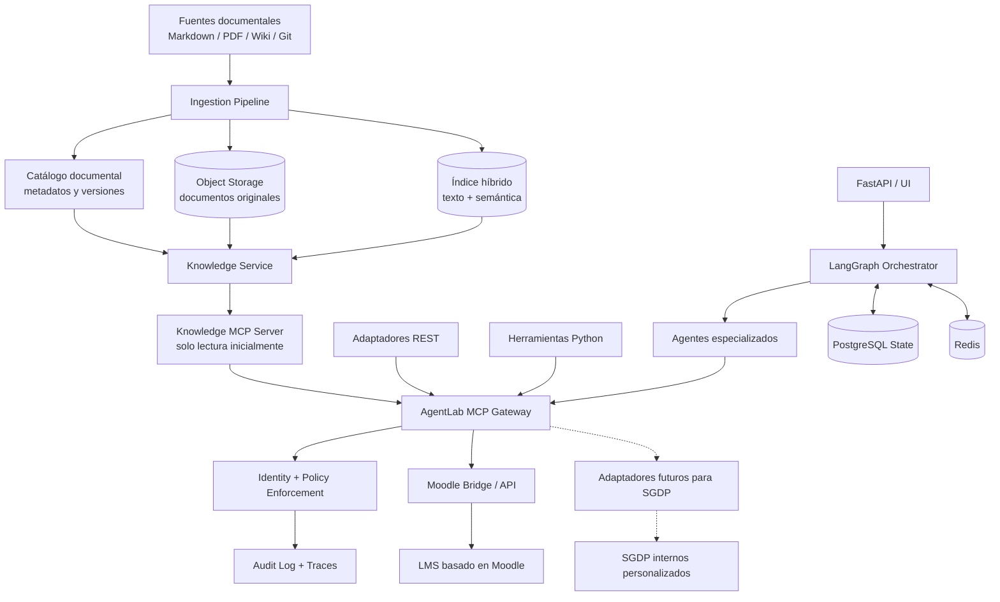

# Marco teórico y arquitectura conceptual

## 1. Propósito

Este documento define el marco conceptual para evolucionar AgentLab hacia una plataforma de conocimiento e integración para agentes de inteligencia artificial.

El objetivo no es crear un agente aislado, sino una base reutilizable para que distintos agentes puedan consultar información de múltiples productos, utilizar herramientas autorizadas y ejecutar workflows trazables, seguros y escalables.

La propuesta parte de una realidad empresarial frecuente:

- Existen múltiples productos y equipos.
- La documentación se encuentra en formatos y repositorios diferentes.
- Los agentes necesitan consultar información común y actualizada.
- Los clientes y usuarios realizan solicitudes repetitivas que hoy requieren intervención operativa.
- Algunas acciones requieren permisos específicos o aprobación humana.
- Las respuestas deben poder justificarse mediante fuentes verificables.

## 2. Problema que se pretende resolver

Sin una capa común, cada agente termina implementando sus propias integraciones, reglas de acceso, búsquedas y mecanismos de auditoría. Esto provoca duplicación, dificultad para mantener la documentación actualizada y riesgo de que un agente acceda a información que no le corresponde.

Además, en plataformas de capacitación y otros productos empresariales, una parte importante de la operación consiste en resolver solicitudes recurrentes: consultar información, actualizar datos básicos, crear cursos, matricular usuarios o aplicar cambios masivos. Estas tareas no siempre requieren el criterio especializado de un operador, pero sí exigen acceso controlado al sistema y una ejecución trazable. El desafío, por tanto, no es solamente responder preguntas, sino habilitar distintos grados de autogestión sin perder control sobre las acciones realizadas.

AgentLab debe separar claramente cinco responsabilidades:

1. Orquestar agentes y workflows.
2. Exponer conocimiento y herramientas mediante contratos estables.
3. Aplicar identidad, permisos y políticas antes de cada acceso.
4. Mantener trazabilidad de documentos, herramientas y decisiones.
5. Evaluar la calidad, seguridad y coste de las ejecuciones.

## 3. Conceptos principales

### 3.1 Plataforma agentic

Una plataforma agentic coordina modelos de lenguaje, estado, memoria, herramientas y políticas para cumplir objetivos de varios pasos. El modelo genera propuestas, pero el sistema controla qué puede hacer, con qué datos y bajo qué condiciones.

AgentLab debe actuar como la capa de ejecución y gobierno de esos workflows.

### 3.2 MCP

Model Context Protocol (MCP) es un protocolo cliente-servidor para que una aplicación host descubra y utilice capacidades externas. Un servidor MCP puede exponer:

- Recursos, como documentos o datos consultables.
- Herramientas, como búsquedas o acciones.
- Prompts o plantillas controladas.

AgentLab debería funcionar principalmente como MCP Host y MCP Client. De forma opcional, también puede exponer un servidor MCP propio para que otros agentes o aplicaciones consuman el conocimiento centralizado.

MCP es un mecanismo de integración. No sustituye la identidad, la autorización, el gobierno de datos ni la auditoría de la organización.

### 3.3 Plataforma de conocimiento

La plataforma de conocimiento es responsable de recibir, normalizar, versionar, indexar y recuperar documentación de productos.

Debe ser independiente del formato original. Un manual puede llegar como Markdown, PDF, HTML, documento de una wiki o contenido de un repositorio, pero el sistema debe transformarlo a un modelo común.

### 3.4 Recuperación aumentada por conocimiento

La recuperación aumentada permite que un agente consulte información actualizada antes de responder. La respuesta debe incluir referencias a los documentos y secciones recuperadas para reducir respuestas no fundamentadas.

El agente no debería acceder directamente a una base de datos vectorial, al filesystem o al almacenamiento de documentos. Debe consultar una capacidad de conocimiento controlada.

### 3.5 Autogestión y automatización operativa

Una plataforma agentic puede evolucionar desde un modelo exclusivamente consultivo hacia un modelo de autogestión y automatización operativa. En el primer nivel, el agente entrega información contextualizada y verificable. En el segundo, permite que un usuario o cliente gestione determinadas tareas dentro de un producto, siempre de acuerdo con sus permisos.

Esta distinción es relevante porque no todas las acciones tienen el mismo riesgo. Las consultas y operaciones de bajo impacto pueden resolverse de forma asistida, mientras que las acciones sensibles, masivas o irreversibles deben incorporar validaciones, confirmación, aprobación humana y auditoría. Por ejemplo, una solicitud para matricular un conjunto de usuarios podría recibirse mediante lenguaje natural o un archivo estructurado, validarse contra las reglas del producto, mostrar un resumen de los cambios y ejecutarse únicamente después de la confirmación correspondiente.

El valor de este enfoque no se limita a mejorar la experiencia del usuario final. También busca reducir la carga de los equipos operadores, de modo que puedan dedicar más tiempo a la gestión, el soporte especializado y la mejora continua del servicio. El agente actúa como una interfaz controlada sobre las capacidades existentes del producto, no como un reemplazo de sus reglas de negocio ni de sus responsables.

En este modelo conviene distinguir tres roles: el usuario final, que puede resolver necesidades personales o consultas simples; el cliente o administrador, que puede solicitar acciones sobre un conjunto de usuarios; y el operador, que supervisa permisos, excepciones y casos que requieren intervención especializada. Esta separación permite diseñar la experiencia y las autorizaciones según el alcance real de cada solicitud.

## 4. Arquitectura propuesta



## 5. Organización de servidores MCP

No se recomienda crear un servidor MCP por cada documento ni automáticamente uno por cada producto.

La primera opción debería ser un servidor común de conocimiento:

```text
knowledge-mcp
  ├── search_product_knowledge
  ├── get_document_section
  ├── list_supported_products
  └── get_product_versions
```

Cada consulta debe exigir filtros explícitos como `tenant_id`, `product_id`, `product_version` y `locale`. El servidor debe validar esos filtros contra la identidad del usuario y las políticas de acceso.

Un MCP independiente por producto se justificaría cuando existan diferencias importantes de:

- Autenticación o autorización.
- Propietario y ciclo de despliegue.
- Clasificación o sensibilidad de los datos.
- Residencia de la información.
- Escalabilidad o aislamiento de fallos.
- Riesgo de las operaciones disponibles.

Los servidores MCP operacionales deben mantenerse separados del servidor de conocimiento. Consultar un manual y ejecutar una acción sobre un producto son capacidades con riesgos diferentes.

Esta separación también permite avanzar por etapas. Un LMS basado en Moodle constituye un punto de partida razonable porque normalmente ofrece mecanismos de integración y una estructura de operación relativamente estandarizada. En cambio, los sistemas internos de gestión del desempeño, capacitación y talento (SGDP) pueden estar altamente personalizados y requerir adaptadores, permisos y workflows específicos para cada cliente. La experiencia obtenida con el LMS puede reutilizarse como base conceptual, pero no debe asumirse que la integración con los SGDP tendrá la misma complejidad o el mismo modelo de datos.

## 6. Relación entre agentes y MCP

Los agentes no deberían incorporar necesariamente paquetes MCP ni conocer la topología de servidores. AgentLab debe encapsular esa complejidad mediante el Tool Registry y el MCP Gateway.

```text
Agente
  ↓
Tool Registry de AgentLab
  ↓
MCP Gateway / adaptadores REST / funciones Python
  ↓
Servicios externos
```

El agente solicita una capacidad lógica como `search_product_knowledge`. AgentLab decide si la resuelve mediante MCP, REST o una función interna.

Un agente debería exponerse como servidor MCP solamente si otro sistema externo necesita consumir sus capacidades. Para la coordinación interna de agentes, LangGraph y el orquestador de AgentLab deben seguir siendo la capa principal.

## 7. Modelo documental común

Cada documento debería tener como mínimo:

- `document_id` estable.
- `source_uri` y sistema de origen.
- `product_id`.
- `product_version`.
- `tenant_id`, cuando aplique.
- Idioma y región.
- Propietario y equipo responsable.
- Fecha de publicación y última actualización.
- Estado: borrador, vigente, obsoleto o retirado.
- Clasificación de seguridad.
- Política de retención.
- Hash o identificador de contenido.
- Secciones y referencias de página.

El pipeline de ingestion debe soportar parsing de Markdown y PDF, extracción de texto, OCR cuando sea necesario, división por secciones, indexación y actualización incremental.

La recuperación debe preservar el vínculo entre cada fragmento y el documento original para que el agente pueda citar producto, versión, sección y página.

## 8. Seguridad y gobierno

### Identidad y autorización

- Propagar la identidad del usuario desde la API hasta el acceso documental.
- Aplicar autorización por usuario, equipo, cliente, producto, versión y clasificación.
- Usar denegación por defecto.
- Preferir tokens de corta duración y audiencias específicas.
- Utilizar OAuth 2.1 para MCP sobre HTTP cuando corresponda.
- Evitar cuentas técnicas con acceso global.

La especificación de autorización de MCP contempla OAuth 2.1, descubrimiento del servidor de autorización, validación de audiencia y protección contra el uso incorrecto de tokens. AgentLab debe aplicar esas reglas en su gateway y no delegar toda la seguridad al modelo.

### Herramientas y límites

- Exponer herramientas estrechas y con esquemas Pydantic.
- Evitar herramientas genéricas como `execute_sql`, `read_any_file` o `fetch_any_url`.
- Mantener las herramientas de conocimiento en modo de solo lectura inicialmente y separar sus permisos de los de las herramientas operacionales.
- Clasificar las operaciones por riesgo y exigir previsualización, confirmación o aprobación humana cuando corresponda.
- Aplicar timeouts, límites de llamadas, cuotas y circuit breakers.
- Requerir aprobación humana para acciones sensibles o irreversibles.

### Contenido no confiable

Los manuales, respuestas de APIs y contenidos recuperados deben tratarse como datos no confiables. Un documento podría contener instrucciones que intenten modificar el comportamiento del agente.

El sistema debe indicar explícitamente que el contenido recuperado no puede sobrescribir las instrucciones del sistema, las políticas de seguridad ni los permisos del usuario.

### Auditoría y observabilidad

Cada ejecución debería registrar, con redacción de secretos y datos sensibles:

- Usuario y aplicación origen.
- Agente y workflow.
- Producto y tenant.
- Herramienta o recurso utilizado.
- Servidor MCP invocado.
- Documento y versión recuperados.
- Resultado, latencia, errores y coste.
- Aprobaciones y decisiones humanas.

Los eventos de auditoría deben tener un `trace_id` común y una política de retención definida.

## 9. Escalabilidad

La primera implementación puede ser un monolito modular con servicios separados para ingestion y MCP cuando existan razones de aislamiento.

Una base inicial razonable sería:

- PostgreSQL para metadatos, estado y checkpoints.
- `pgvector` y búsqueda de texto completo para el primer índice híbrido.
- S3 o MinIO para documentos originales.
- Redis para caché y coordinación temporal.
- Workers asíncronos para ingestion y reindexación.
- OpenTelemetry para trazas.

La separación en microservicios debe responder a límites de seguridad, propiedad, escalabilidad o despliegue, no solamente a la cantidad de componentes.

## 10. Cumplimiento

AgentLab no puede garantizar por sí solo el cumplimiento normativo. Debe proporcionar controles y evidencias para que la organización pueda realizar un análisis legal y de riesgos según sus países, sectores y tipos de datos.

Como referencias de diseño se pueden utilizar:

- NIST AI Risk Management Framework y su perfil para IA generativa.
- NIST Cybersecurity Framework 2.0.
- GDPR cuando se procesen datos personales dentro de su ámbito.
- EU AI Act cuando el sistema entre en su ámbito de aplicación.
- ISO 27001, SOC 2 u otros requisitos contractuales de los clientes.

La aplicabilidad concreta debe revisarse con seguridad, privacidad, legal y cumplimiento. El marco técnico debe permitir documentar clasificación de riesgo, responsables, controles, retención, ubicación de datos, incidentes y revisiones periódicas.

## 11. Alcance inicial recomendado y evolución del piloto

El primer piloto debería concentrarse en un único LMS basado en Moodle y en un conjunto acotado de casos de uso. El objetivo no sería construir desde el inicio una solución para todos los productos, sino validar un puente de integración con la plataforma y comprobar cómo un agente puede combinar conocimiento, permisos y acciones controladas.

El piloto podría evolucionar en tres niveles:

1. Consultas sobre un único producto, filtradas por versión, cliente y permisos, con respuestas fundamentadas en la documentación disponible.
2. Funciones de autogestión de bajo riesgo para usuarios y clientes, como la actualización de determinados datos o la gestión de solicitudes frecuentes, aplicando controles adicionales a cualquier operación relacionada con credenciales.
3. Operaciones asistidas para clientes u operadores, como crear cursos, matricular usuarios o asignarlos a grupos. Las solicitudes masivas podrían recibirse mediante un archivo o una instrucción estructurada, validarse y presentarse para confirmación antes de su ejecución.

Cada ejecución debería registrar quién solicitó la acción, qué se validó, qué cambios se realizaron y qué elementos quedaron pendientes o rechazados. Esto permitiría medir, además de la calidad de las respuestas, la reducción de trabajo operativo y la capacidad del sistema para derivar excepciones a un operador.

Una vez validado este enfoque en Moodle, la solución podría extenderse a los SGDP internos. Debido a su alto nivel de personalización, esta segunda etapa debería abordarse mediante adaptadores y workflows específicos, sin asumir que las capacidades, permisos y reglas del LMS se pueden trasladar directamente.

## Referencias

- [Model Context Protocol: especificación](https://github.com/modelcontextprotocol/modelcontextprotocol/blob/main/docs/specification/2026-07-28/basic/index.mdx)
- [Model Context Protocol: autorización](https://github.com/modelcontextprotocol/modelcontextprotocol/blob/main/docs/specification/2026-07-28/basic/authorization/index.mdx)
- [NSA: MCP Security Design Considerations](https://www.nsa.gov/Press-Room/Press-Releases-Statements/Press-Release-View/Article/4496698/nsa-releases-security-design-considerations-for-ai-driven-automation-leveraging/)
- [NIST AI Risk Management Framework](https://www.nist.gov/itl/ai-risk-management-framework)
- [NIST AI RMF: Generative AI Profile](https://www.nist.gov/publications/artificial-intelligence-risk-management-framework-generative-artificial-intelligence)
- [NIST Cybersecurity Framework 2.0](https://www.nist.gov/publications/nist-cybersecurity-framework-csf-20)
- [GDPR en EUR-Lex](https://eur-lex.europa.eu/legal-content/EN/TXT/?uri=legissum%3A310401_2)
- [EU AI Act en EUR-Lex](https://eur-lex.europa.eu/legal-content/EN/ALL/?uri=OJ%3AL_202401689)
